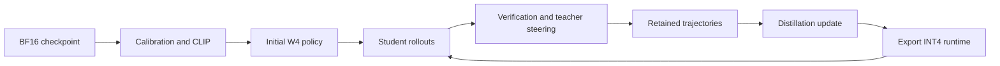

# SteerDistill

**Quantizing LLM Agents via Online Teacher-Steered Trajectory Distillation**

[Getting started](#requirements) · [Training](#method-flow) · [Models and benchmarks](benchmarks/README.md) · [Case studies](case_studies/bfcl_v4_40_cases/README.md) · [Reproducibility](REPRODUCIBILITY.md)

Train a W4A16 agent with teacher guidance during training, then run the
quantized agent without a teacher or steering at inference time.

| Models | Benchmarks | Quantization |
| --- | --- | --- |
| Qwen3-8B, Qwen3.5-4B, Gemma 4 12B-it | BFCL V4, tau^2-Bench, WebShop, ALFWorld, Search QA | W4A16, group size 64 |

## Start here

| Goal | Entry point |
| --- | --- |
| Install dependencies and prepare the environment | [Requirements](#requirements) and [environment versions](REPRODUCIBILITY.md) |
| Configure BF16 models and download benchmark data | [Model paths and benchmark setup](benchmarks/README.md) |
| Prepare calibration data and the initial W4 runtime | [Quantization preparation](prepare_quant_assets.sh) and [runtime preparation](prepare_initial_runtime.sh) |
| Run online trajectory distillation | [Benchmark launcher](run_benchmark.sh) and [online training](run_online.sh) |
| Find benchmark-specific evaluation commands | [Benchmark guide](benchmarks/README.md) |
| Inspect reasoning, actions, and failure cases | [40 cases with seven-method comparisons](case_studies/bfcl_v4_40_cases/README.md) |

The case collection includes original tasks, 280 selected trajectories, readable
reasoning and tool responses, scores, and per-case divergence analyses.

## Overview

SteerDistill implements online teacher-steered trajectory distillation for
BFCL V4, tau^2-Bench, WebShop, ALFWorld, and Search QA with Qwen3-8B,
Qwen3.5-4B, and Gemma 4 12B-it. It trains a W4A16 policy from the clipped initial W4
checkpoint, uses a frozen BF16 model to analyze verified failures, and
distills verifier-approved skill-aware behavior back into the same W4 policy.
The default route is SteerDistill; Offline, QAT, RLVR, and other ablations are
not selected by any entry point in this directory.

The runtime uses asymmetric `int4` quantization with group size
64, standard AWQ packing, and the AWQ-Marlin kernel. AWQ is only the exported
runtime layout here; no GPTQ calibration or second quantization search is
performed.

## Method flow



<details>
<summary><strong>Online update, repair acceptance, and context handling</strong></summary>

For each online optimizer step:

1. The current W4 policy samples 16 complete trajectories, one per selected
   training task, through the configured benchmark environment.
2. The frozen BF16 teacher supplies a successful reference when one exists.
   Tool-use runs also collect BF16 master diagnostics, but these are not
   eligible repair references. Without a successful teacher reference,
   the original student trajectory enters training unchanged.
3. The teacher analyzes the first action divergence and creates or revises one
   integrated steering instruction for the current repair trajectory.
4. The W4 policy retries from an exact environment snapshot captured at the
   causal anchor. The snapshot contains the writable environment state, the
   complete conversation prefix, and the trajectory prefix. Each failed retry
   is fed back to the teacher to revise the Steer, for at most four attempts.
   Tool interventions are checked immediately after execution and before the
   next student request. A rejected transition stops that attempt. The checker
   compares canonical SQLite states, not action names: writes must reach the
   reference state without extra business-state changes; reads must leave that
   state unchanged and return the same canonical information. Each task gets a
   policy derived from its environment source and verifier. Only automatically
   generated clock columns unused by the verifier and business logic can be
   excluded. Business dates, logs, primary keys, unknown dynamic access and
   user-supplied timestamps retain strict checks. Source identities and the
   exact exclusions are saved beside each trajectory in `transition_policy.json`.
   If all W4 attempts fail, return the retained trajectory, including any
   previously accepted corrections. The teacher does not take over actions.
   Accepted actions are executed only once; continuation uses their verified
   feedback. Realignment may revisit a repaired turn, in which case acceptance
   removes intervention records from that turn onward. If alignment cannot
   identify a repair position, retain the trajectory and record that outcome.
   Native benchmark prompts retain all earlier responses, including reasoning,
   and observations within the context-window termination policy below.
5. Only the retained trajectory is materialized into the Steer OPD dataset;
   discarded errors and suffixes are excluded. The learner uses
   full-vocabulary, token-normalized reverse KL for ordinary rows,
   and forward KL against frozen, verifier-grounded steered W4 references
   for accepted corrections.
6. All assistant turns and accepted repair targets from these 16 trajectories
   contribute to one global token-normalized objective. Each rank processes
   one turn per forward pass by default (`ONLINE_TURN_BATCH_SIZE`),
   accumulates every turn, and performs
   exactly one optimizer update. Model, optimizer, and scheduler state persist
   across batches. The updated INT4/g64 runtime is exported and checked before
   sampling the next 16 trajectories with that new student.

The skill store is an append-only audit log. A skill can move through
`proposed`, `verified`, `internalized`, `regressed`, `retained`, or `retired`,
with each transition tied to verifier evidence and checkpoint identity. The
runtime reads a steering instruction only for the current step and repair
trajectory. It does not carry a prompt from an earlier trajectory, step, or
task into a new rollout. Within one repair trajectory, each Teacher revision
replaces the previous prompt with one newly integrated instruction.

The 32768-token limit covers the rendered prompt plus the generated response.
For WebShop and ALFWorld, `ACTION_MAX_TOKENS` separately limits each response
to 4096 tokens by default. Generation stops at `</action>` and includes that
closing tag in the returned response, preserving the preceding reasoning.
This protocol boundary applies to both teacher and student, in training and
evaluation. It does not certify action validity or task success; the environment
still checks both. Search QA and tool-call benchmarks retain their own protocols.
When a tool observation exhausts the next request's context, the adapter saves
the existing trajectory and database with `termination_reason=context_length`.
When generation reaches its token budget, it records `generation_length` and
stops after any returned tool action. Raw observations and sampled tokens stay
intact; no earlier history is removed to continue the rollout. The verifier
still determines success, and rejected runs enter the normal repair pipeline.
Completed assistant turns remain available for ordinary distillation; verified
repair targets follow the same acceptance rules as other runs.

Teacher analyses use a JSON schema and remain subject to causal grounding and
local transition checks. Invalid analyses are retried with feedback; exhausted
retries retain the existing trajectory and record the rejection. Network and
server failures remain errors.

After inspecting a failed rollout, `OPD_RESUME_ROLLOUT_ONLY=1` permits resuming
that batch only when its recorded inputs match and its training directory is
empty. Completed task shards are checked before reuse. This option does not
recover partially executed optimizer updates.

Concurrent native rollout jobs can set `NATIVE_STUDENT_GPU`,
`NATIVE_TEACHER_GPU`, and distinct `BASE_PORT` values. Assign disjoint devices
to those jobs and set the same `GPU_POOL_LOCK` file for all online schedulers.
Native rollouts acquire a shared lock; tool-environment rollouts and parameter
updates acquire an exclusive lock. `TRAIN_GPU_IDS` selects the training devices.
External calibration and evaluation jobs sharing this GPU pool must also hold
the shared lock and use disjoint devices, or run outside these online jobs.

</details>

## Requirements

- Linux with Bash and separate training, inference, and benchmark Python
  environments. Package versions, CUDA requirements, and external source
  revisions are listed in [REPRODUCIBILITY.md](REPRODUCIBILITY.md).
- The external tool-use adapter uses a separate Python 3.12 environment.
  Install its checkout together with `requirements-tool-env.txt`; the MCP
  compatibility constraint prevents installing the incompatible 2.x API:
  `uv pip install --python "$TOOL_ENV_PYTHON" -e "$TOOL_ENV_ADAPTER_ROOT" -r "$STEERDISTILL_ROOT/requirements-tool-env.txt"`.
- Eight A100-class GPUs for the default tool-use rollout: four W4 rollout
  replicas, two BF16 shadow replicas, and two BF16 teacher replicas.
- A BF16 teacher model, the clipped initial BF16/W4 master, the tool-use environment executable,
  tool-use environment source environments, and the BFCLv4 prompt manifest.
  The environment adapter must support exact state snapshots and restoration.
  Apply `patches/tool_environment_context.patch` from the external adapter's
  repository root (`patch -p1 < "$STEERDISTILL_ROOT/patches/tool_environment_context.patch"`).
  Then apply `patches/tool_environment_transition.patch` from the same root
  (`patch -p1 < "$STEERDISTILL_ROOT/patches/tool_environment_transition.patch"`).
  Reinstall the adapter if its installation does not use the edited checkout.
  For a custom executable wrapper, set `TOOL_ENV_PYTHON` to the interpreter
  used by that wrapper so preflight inspects the installed adapter.
  This patch targets the snapshot-enabled adapter: context exhaustion is a
  recorded rollout termination, not a failed HTTP request that loses the run.
- The pinned packages in `requirements.lock`. The online scheduler starts
  and stops inference servers around each rollout batch.
- A writable method root with enough storage for rollouts and checkpoints.

From the repository root, choose external asset and environment directories:

```bash
export STEERDISTILL_ROOT="$PWD"
export STEER_ASSET_ROOT="$(dirname "$PWD")/steerdistill-assets"
export ENV_ROOT="$STEER_ASSET_ROOT/envs/train"
export INFERENCE_ENV_ROOT="$STEER_ASSET_ROOT/envs/inference"
export BENCHMARK_ENV_ROOT="$STEER_ASSET_ROOT/envs/benchmarks"

python3.10 -m venv "$ENV_ROOT"
"$ENV_ROOT/bin/python" -m pip install torch==2.7.1 --index-url https://download.pytorch.org/whl/cu126
"$ENV_ROOT/bin/python" -m pip install -r requirements.lock
```

Prepare the separate inference and benchmark environments using
[REPRODUCIBILITY.md](REPRODUCIBILITY.md) and the benchmark-specific upstream
installation links in [benchmarks/README.md](benchmarks/README.md).
Export model and data path overrides listed in `benchmarks/paths.example.env`.
Keep private settings and API credentials outside the repository. Entry points
load `config.example.env`; `STEER_CONFIG` can select a private copy that sources
this template after setting path overrides. When switching routes, use a fresh
shell or a subshell and do not carry derived model or run paths from another route.
The default external layout is:

```text
models/<model-family>/<checkpoint-group>/
benchmarks/<benchmark>/rl_train.jsonl
benchmarks/<benchmark>/prompts.jsonl
benchmarks/<benchmark>/environment/
runs/<model-family>/<benchmark>/
```

The model and benchmark assets are external dependencies and are intentionally
excluded from the source archive. Use the upstream public resources:

- BF16 teacher: the checkpoint after the paper's benchmark-specific BF16 RL stage;
  provide its local path with `TEACHER_MODEL`.
- tool-use environment/BFCLv4 data and environment: [Snowflake/AgentWorldModel-1K](https://huggingface.co/datasets/Snowflake/AgentWorldModel-1K)
- Upstream code attribution and licenses: [THIRD_PARTY_NOTICES.md](THIRD_PARTY_NOTICES.md).

The complete three-model path registry, shared tool-use checkpoint rule, and
stage commands are in [benchmarks/README.md](benchmarks/README.md). Set
`TOOL_ENV_ADAPTER_ROOT` to the external adapter checkout and `TOOL_ENV_BIN`
to its installed executable. All
generated data, CLIP caches, training signals, and evaluation outputs stay
under the external run root; none belong in the source archive.

## Preflight and tests

```bash
cd "$STEERDISTILL_ROOT"
set -a
source config.example.env
set +a
bash preflight.sh
"$ENV_ROOT/bin/python" -m compileall -q .
"$ENV_ROOT/bin/python" -m unittest discover -s tests -v
find . -type d \( -name __pycache__ -o -name .pytest_cache \) -prune -exec rm -rf {} +
bash check_release.sh
```

Preflight checks the SteerDistill files, BFCLv4 selection, shell syntax, and
whether the initial AWQ runtime has been prepared. It also checks training
dependency versions and the inference CUDA compiler, headers, and libraries.
Unit tests do not require a
GPU and cover divergence parsing, skill injection, append-only state
transitions, token alignment, KL direction, frozen references, W4 packing,
and trainable backpropagation. `check_release.sh` rejects private paths,
identity metadata, credentials, generated checkpoints, and dataset files.

Environment integration tests are opt-in with `STEER_TEST_ENVIRONMENTS=1`
and require the corresponding external assets. Full BFCL requires
`SERPAPI_API_KEY`; tau2 requires a configured user simulator. The default
training route restarts inference after each export for all three model families.

Training packages are pinned in `requirements.lock`. The configured training
window is 32768 tokens across the three model families.
Complete assistant responses are retained; a response or
Steer prompt that does not fit fails closed instead of being silently truncated.
External source revisions, asset URLs, checksum generation, GPU details, and seed
recording are documented in REPRODUCIBILITY.md.

Validate an exported runtime against its source with:

```bash
"$ENV_ROOT/bin/python" validate_awq_runtime.py \
  --source "$INITIAL_W4_MASTER" --clip "$CLIP_PATH" \
  --runtime "$INITIAL_RUNTIME_W4" --bits 4 --group-size 64 --layers 0
```

## BFCLv4 rollout smoke test

Use one prompt and one free GPU to validate vLLM loading, tool-use environment execution, and
deterministic verification without starting training:

```bash
set -a
source "${STEER_CONFIG:-$STEERDISTILL_ROOT/config.example.env}"
set +a
TMP=$(mktemp -d "$STEER_ASSET_ROOT/steerdistill-smoke.XXXXXX")
head -n 1 "$PROMPT_MANIFEST" > "$TMP/prompts.jsonl"
WORKERS_PER_ENDPOINT=1 MAX_NUM_SEQS=1 MAX_ITERATIONS=2 MAX_TOKENS=128 \
  bash run_tool_use_policy.sh \
  "$INITIAL_RUNTIME_W4" \
  "$TMP/rollout" "$TMP/prompts.jsonl" "${SMOKE_GPU_ID:-0}" 35510 bfloat16 1
cat "$TMP/rollout/attempts.jsonl"
```

The smoke command should produce `TEACHER_VERIFY_SIGNAL`,
`TEACHER_DATA_SIGNAL`, and `SKILL_POLICY_ROLLOUT_SIGNAL`. A rejected task is
still a successful smoke test when `execution_status=success` and
`verify_state=complete`; rejection means the short rollout did not solve the
task, not that the pipeline crashed.

This optional command requires the initial runtime from the `quantize` stage.
It starts an AWQ-Marlin endpoint and writes a trajectory and verifier result.
The default training route needs eight A100 80GB GPUs. Each
step stores a BF16 master, an INT4 runtime, and trajectories; the learner
retains its two most recent optimizer checkpoints. Plan disk capacity for
the requested number of steps and measure runtime on the actual task mix.

## Full BFCLv4 route

Configure external BF16 models and benchmark inputs, then run:

```bash
export BENCHMARK=bfcl_v4
export MODEL_FAMILY=qwen3_8b
export OPD_GLOBAL_BATCH_SIZE=16
export OPD_EPOCHS=2
export LEARNING_RATE=8e-6
export OPD_MAX_STEPS=0
export ONLINE_TURN_BATCH_SIZE=1
export GPU_IDS=0,1,2,3,4,5,6,7
bash run_benchmark.sh full
```

`run_online.sh GPU_IDS` is the scheduler entry point after initial
quantization. `run_bfclv4.sh GPU_IDS` is a convenience training entry point.
`OPD_EPOCHS` counts shuffled passes through the training task manifest;
`OPD_MAX_STEPS=0` disables early stopping; a positive value caps optimizer
updates for explicit bounded runs. The final smaller batch is retained
in each epoch, so steps per epoch are `ceil(number_of_tasks / 16)`.
Every task is sampled once per epoch. Each update normalizes by its actual
active token count; empty distributed slots contribute zero loss.
`ONLINE_TURN_BATCH_SIZE=1` controls assistant-turn forwards, not trajectory
count. The global trajectory batch remains 16 and is accumulated into one
optimizer update.
The Trainer transport batch and its outer accumulation are both one because
the online worker handles accumulation over the complete trajectory batch.

```bash
# Evaluate the latest fully committed online checkpoint.
bash run_benchmark.sh eval
# Or select an earlier completed step.
EVAL_STEP=2 bash run_benchmark.sh eval
```

Completed steps are resumable after checking configuration, model lineage,
and output checksums. Partial steps fail closed for inspection. Optimizer and
scheduler state must match the previous committed step; they are never reset
silently. BFCL V4 and tau^2-Bench share the training root and online checkpoints.

Each step writes `run_manifest.json`. It contains package versions, external
source revisions, relative asset checksums, GPU names, step budgets, and the
configured seed-related values without recording absolute machine paths or
credentials. To create the same manifest before a smoke run, use the command
in `REPRODUCIBILITY.md`.

For a single reproducibility entry point, run `reproduce_results.sh smoke` for
the bounded verifier smoke test or `reproduce_results.sh full` for the full
configured quantization, online training, and evaluation sequence. Generated
manifests and verifier artifacts stay under the external run root.

The scheduling reference is NVIDIA NeMo-RL commit
`39eeee7eb66ccb8c4f57e03fa2e0f1e8e37a250d`, specifically
`examples/modelopt/qa_distillation_math_megatron.yaml`, `distillation.py`, and
`megatron_policy_worker.py`. Only the rollout, global-batch accumulation,
update, fresh-rollout order is adapted. SteerDistill retains its own CLIP,
INT4/g64, repair, reverse-KL, and forward-KL implementation; this is not an
NVFP4, Megatron, or top-k KL implementation.

## Outputs

```text
online/run_config.json                          immutable run configuration
online/latest.json                              latest committed student
online/skill_store/events.jsonl                 append-only repair history
online/steps/stepNNNNNN/prompts.jsonl             sampled task batch
online/steps/stepNNNNNN/{plain,repairs,tasks}/     trajectories and snapshots
online/steps/stepNNNNNN/train/steer_opd.jsonl      all retained turn targets
online/steps/stepNNNNNN/train/training_manifest.json
online/steps/stepNNNNNN/train/training_signal.json
online/steps/stepNNNNNN/complete.json             model/optimizer lineage
online/checkpoints/learner/checkpoint-N/          persistent optimizer state
online/checkpoints/student-stepNNNNNN-hf/        learner BF16 master
online/checkpoints/student-stepNNNNNN-awq-runtime/
```

The step fails if a trajectory is missing, a real turn is skipped or repeated,
targets are not aligned, optimizer continuity breaks, or exported W4 tensors
do not match the source quantizer. Ordinary-only batches require recorded
success or exhausted repair attempts; they do not demonstrate repair loss.

## External assets

The source tree contains the SteerDistill route, tests, release metadata,
and documentation. Experiment caches remain outside the release archive. Model weights, prompt
data, tool-use environments, and checkpoints are external downloads and are not
redistributed by this package.
